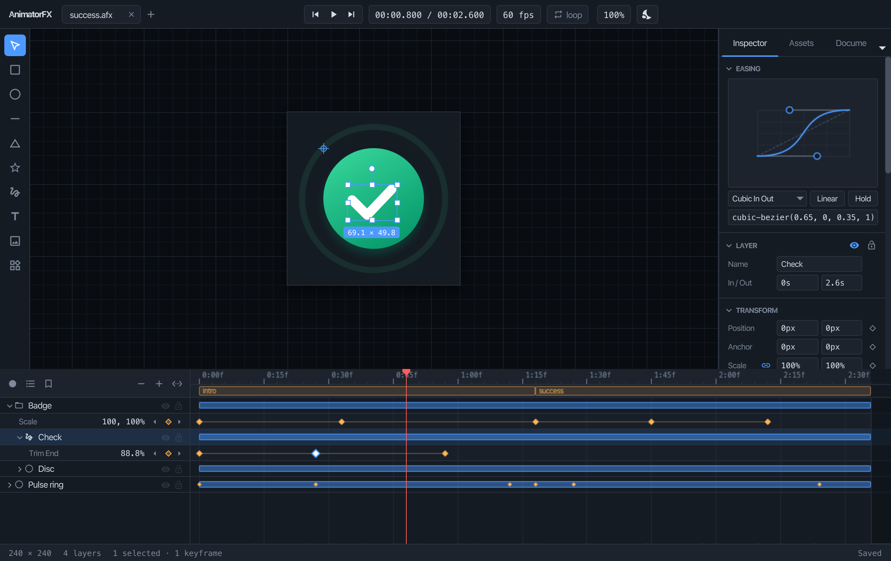
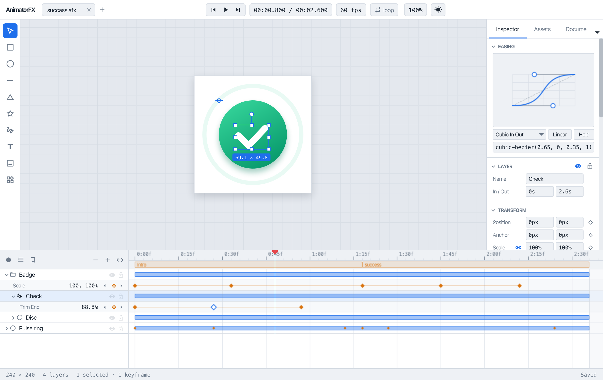
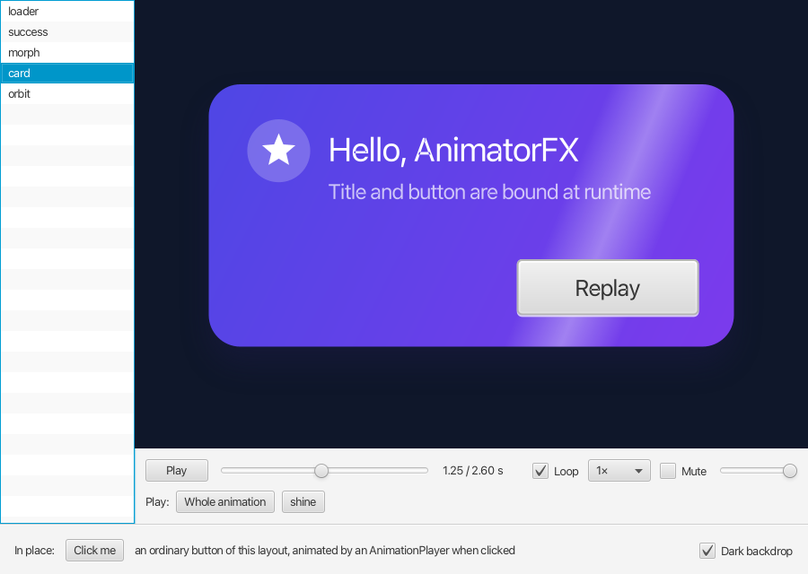
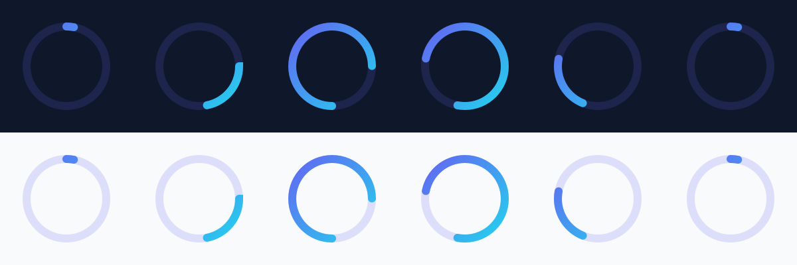
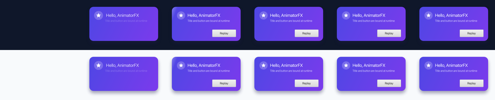
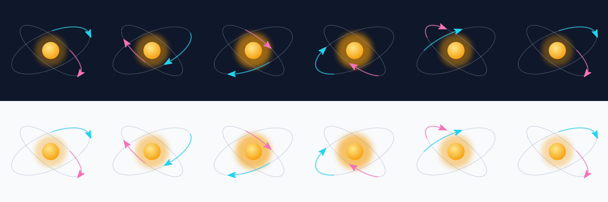

# AnimatorFX

AnimatorFX is a keyframe animation editor for JavaFX and a small runtime library that plays the
animations it creates inside JavaFX applications.

- You **author** an animation in the desktop editor and save it as an `.afx` file.
- Your application **plays** it with the `AnimationView` control. It needs one dependency,
  `animatorfx-player`, and none of the tooling.
- An animation can mix **vector content** (shapes, paths, text, images) with **slots**: named
  placeholders that the application fills with its own nodes, which the animation then drives.



<details>
<summary>Light theme</summary>



</details>

## Contents

- [Features](#features)
- [Modules](#modules)
- [Requirements](#requirements)
- [Quick start](#quick-start)
- [Embedding animations](#embedding-animations)
- [The editor](#the-editor)
- [The `.afx` format](#the-afx-format)
- [Importers](#importers)
- [Known limitations](#known-limitations)
- [Project layout](#project-layout)
- [Development](#development)
- [License](#license)

## Features

**Runtime**

- `AnimationView`, a resizable control: play, pause, seek, rate (also negative), cycle count,
  auto-reverse, fit modes, auto-play, CSS styleable.
- `AnimationPlayer`, the non-visual controller behind it, usable on its own.
- Markers: named time ranges that can be played by name.
- Slots, in two modes: *embedded* (your node lives inside the animation) and *in place* (your
  node stays in your layout and is moved, scaled, rotated and faded by the animation).
- Shapes (rectangle, ellipse, line, polygon, star, Bezier path), text, images, groups.
- Solid, linear and radial paints; strokes with caps, joins and dashes; trim paths.
- Path morphing, motion paths with orient-to-path, clip and alpha masks, blur, drop shadow, glow.
- Scene-graph rendering, so content stays crisp at any size. One `AnimationTimer` per player,
  running only while playing.
- Java 21, JavaFX 21, JPMS modules, no third-party dependencies.

**Editor**

- Canvas with select, shape, pen, text, image and slot tools, snapping, zoom and pan.
- Timeline with a layer tree, keyframes, markers, in/out bars and a scrubbing playhead.
- Inspector with a keyframe toggle on every animatable property and a cubic-bezier easing editor.
- Auto-key, undo/redo, copy/paste of layers and keyframes, groups.
- Import of SVG, Lottie JSON and FXML.
- Dark and light theme, or follow the system.
- Session restore and crash recovery.

## Modules

| Artifact | JPMS module | Purpose | Depends on |
|---|---|---|---|
| `animatorfx-model` | `com.dlsc.animatorfx.model` | Immutable document model, interpolation, easing, `.afx` reader and writer | `java.base` |
| `animatorfx-player` | `com.dlsc.animatorfx.player` | Evaluator, renderer, `AnimationPlayer`, `AnimationView`, slot binding | model, `javafx.controls` |
| `animatorfx-import` | `com.dlsc.animatorfx.importer` | SVG, Lottie and FXML importers | model, `javafx.fxml` |
| `animatorfx-editor` | `com.dlsc.animatorfx.editor` | The authoring tool | model, player, import, AtlantaFX, Ikonli |
| `animatorfx-sample-app` | `com.dlsc.animatorfx.sample` | Sample application (in `samples/`) | player |

Group id `com.dlsc.animatorfx`, version `1.0-SNAPSHOT`.

**An application needs `animatorfx-player` only.** It brings `animatorfx-model` transitively.

## Requirements

| | Java | JavaFX | Other dependencies |
|---|---|---|---|
| Runtime (`model`, `player`) | 21 or later | 21 or later | none |
| Editor and importers | JDK 26 | 25 | AtlantaFX 3.0.0, Ikonli 12.4.0 |

Building the whole project needs **JDK 26** and Maven 3.9. The runtime modules are compiled with
`--release 21` against JavaFX 21.0.13.

## Quick start

All commands run from the repository root with a JDK 26 as `JAVA_HOME`.

```bash
# build everything and run all tests (headless)
mvn clean install

# run the editor
mvn -pl animatorfx-editor javafx:run

# run the sample application
mvn -pl samples/animatorfx-sample-app javafx:run

# package the editor as a native application image
mvn -Ppackage -pl animatorfx-editor -am package
```

The two `javafx:run` commands need the modules in the local Maven repository, so run
`mvn clean install` first.

Options for running the editor:

```bash
mvn -pl animatorfx-editor javafx:run \
    -Danimatorfx.args="$PWD/samples/animations/success.afx" \
    -Danimatorfx.configDir=/path/to/a/scratch/dir
```

`animatorfx.args` are the files to open (absolute paths; the editor runs in its module directory); `animatorfx.configDir` moves the session directory (see
[Session and recovery](#session-and-recovery)).

### The sample application



`samples/animatorfx-sample-app` is a plain JavaFX window (Modena, no AtlantaFX) that depends on
`animatorfx-player` and nothing else; a test and a Maven Enforcer rule keep it that way. It plays
the files of `samples/animations`:

| File | Shows |
|---|---|
| `loader.afx` | A spinner: a stroked arc with round caps and animated trim start, end and offset, looping seamlessly |
| `success.afx` | A badge that pops in with overshoot, a check mark drawn on with a trim path, a ring pulse; markers `intro` and `success` |
| `morph.afx` | Play, pause and stop morphing into each other through path keyframes, with animated gradients |
| `card.afx` | A card with a drop shadow, a masked shine sweep and two slots, `title` and `action`; marker `shine` |
| `orbit.afx` | Two shapes following motion paths, oriented to the path, with trimmed trails and a blurred glow |
| `attention.afx` | A single slot that wiggles; used to animate an ordinary button in place |







The files are generated with the model API by `SampleGenerator` (test scope of the sample
application), and a test checks that the committed files match. To write them again:

```bash
mvn -pl samples/animatorfx-sample-app test -Dtest=SampleFilesTest -Danimatorfx.samples.write=true
```

### Packaging

`mvn -Ppackage -pl animatorfx-editor -am package` produces an application image for the platform
it runs on in `animatorfx-editor/target/dist` (`AnimatorFX.app` on macOS). Add `-DskipTests` if
the tests have already run. The profile

1. copies the editor and its runtime dependencies, all of them explicit JPMS modules, to
   `target/package/modules`,
2. links a trimmed Java runtime that contains them with `jlink` (`target/package/runtime`),
3. wraps that runtime with `jpackage --type app-image` (name AnimatorFX, version 1.0.0, bundle
   identifier `com.dlsc.animatorfx.editor`, and on macOS the icon `src/package/macos/AnimatorFX.icns`).

```bash
# macOS: start the packaged application
open animatorfx-editor/target/dist/AnimatorFX.app
# or, with a console and files to open
animatorfx-editor/target/dist/AnimatorFX.app/Contents/MacOS/AnimatorFX "$PWD/samples/animations/success.afx"
```

The image is not signed or notarized, there is no installer, and `.afx` files are not associated
with the application. Only the macOS (Apple Silicon) image has been built and started; on Windows
and Linux the profile uses the default icon and has not been tried. The icon is drawn by
`animatorfx-editor/src/package/IconGenerator.java`; `make-icons.sh` next to it rebuilds the PNG and
the `.icns`.

## Embedding animations

The artifacts are not published to a public repository yet: run `mvn clean install` once, then
depend on the player.

```xml
<dependency>
    <groupId>com.dlsc.animatorfx</groupId>
    <artifactId>animatorfx-player</artifactId>
    <version>1.0-SNAPSHOT</version>
</dependency>
```

```java
module com.example.app {
    requires com.dlsc.animatorfx.player;   // brings the model, javafx.graphics and javafx.controls
}
```

### Loading and playing

`AnimationIO.read` accepts a `Path`, a `URL` or an `InputStream` and returns an `AnimationFile`:
the document plus the bytes of its assets. It throws `IOException` — an `AnimationFormatException`
when the content is not a valid document — which the snippets below leave to the caller.

```java
AnimationFile file = AnimationIO.read(getClass().getResource("success.afx"));

AnimationView view = new AnimationView(file);
view.setFit(Fit.CONTAIN);                         // CONTAIN (default), COVER or NONE
view.setCycleCount(AnimationPlayer.INDEFINITE);   // default 1
view.setRate(1.5);                                // negative plays backwards
view.play();

view.pause();
view.seek(0.5);                                   // seconds; also view.setCurrentTime(0.5)
view.stop();                                      // back to the start

view.setAutoPlay(true);                           // start when the view is shown
```

`AnimationView` is a resizable control. Its preferred size is the document size; the content is
scaled uniformly, centred and clipped to the view. Playback pauses by itself while the view is not
part of a showing window.

Fit and auto-play can also be set from CSS (style class `animation-view`):

```css
.animation-view {
    -fx-fit: cover;        /* contain | cover | none */
    -fx-auto-play: true;
}
```

`view.getPlayer()` returns the `AnimationPlayer` with the remaining properties and events
(`autoReverse`, `status`, `activeMarker`, `onFinished`, `onMarkerReached`).

### Markers

A marker is a named time range of the document. `playMarker` plays that range and respects cycle
count and auto-reverse; an unknown name throws `IllegalArgumentException`.

```java
view.playMarker("intro");
view.getPlayer().setOnFinished(event -> view.playMarker("success"));
view.getPlayer().setOnMarkerReached(marker -> System.out.println("reached " + marker.name()));
```

### Slots

A slot is a placeholder layer with a name. There are two ways to fill it.

**Embedded** — the node becomes part of the animation. It is placed in the view, resized to the
slot's size if it is resizable, and gets the slot's full transform, opacity, mask and effects.

```java
AnimationView card = new AnimationView(AnimationIO.read(getClass().getResource("card.afx")));
card.bind("title", titleLabel);
card.bind("action", actionButton);
```

**In place** — the node stays where your layout puts it. The player drives its `translateX/Y`,
`scaleX/Y`, `rotate`, `opacity`, `visible` and `effect` relative to the slot's rest transform. No
view is needed:

```java
AnimationPlayer player = new AnimationPlayer(AnimationIO.read(getClass().getResource("attention.afx")));
player.bindInPlace("target", button);
player.setOnFinished(event -> player.unbind("target"));
player.play();
```

With a view, `autoBind` binds every still unbound slot in place to the node whose id equals the
slot name. `FXMLLoader` does not copy `fx:id` to the node id, so there is a variant that looks in
the FXML namespace first:

```java
view.autoBind(root);                          // looks up "#<slotName>" under root
view.autoBind(root, loader.getNamespace());   // fx:id first, then the node id
```

**Unbinding** — `view.unbind(name)` or `player.unbind(name)` restores every property the binding
changed to its value at bind time and, for an embedded node, removes it from the view. Binding a
slot again replaces the earlier binding. Binding an unknown slot name throws
`IllegalArgumentException`; a slot that is left unbound is skipped and logged once.

The editor writes this code for a document: *Document* tab ▸ *Copy Java Snippet*.

## The editor

### Layout

- **Toolbar** (top): document tabs, transport (to start, play/pause, to end), timecode, frame
  rate, loop, zoom, theme switch.
- **Tool rail** (left): the tools below.
- **Canvas** (centre): the artboard with selection handles, path and motion-path editing and
  snap guides. It previews through the same renderer the runtime uses.
- **Side panel** (right): *Inspector* (properties of the selection, easing), *Assets* (images and
  fonts), *Document* (name, size, duration, frame rate, background, markers, Java snippet).
- **Timeline** (bottom): layer tree on the left; ruler, marker lane, in/out bars, keyframes and
  the playhead on the right.
- **Status bar**: document size, layer count, selection, autosave state.

### Tools and shortcuts

| Tool | Key | Notes |
|---|---|---|
| Select | `V` | Click, Shift-click, marquee; drag moves; handles scale and rotate; double-click enters a group or edits a path or text |
| Rectangle, Ellipse, Line | `R`, `O`, `L` | Drag to draw; Shift = square, circle or 45°; Alt = from the centre |
| Polygon, Star | `Y`, `S` | |
| Pen | `P` | Click = corner, drag = smooth point; click the first point to close; Enter finishes |
| Text | `T` | Click to place, type, Enter commits |
| Image | `I` | Places a PNG or JPEG, which becomes an asset of the document |
| Slot | `K` | Drag a rectangle and name the slot |

| Action | Shortcut (`Cmd` on macOS, `Ctrl` elsewhere) |
|---|---|
| Play / pause | `Space` |
| Pan | `Space` + drag, middle-button drag, scroll |
| Zoom | `Cmd` + scroll, pinch, `Cmd =`, `Cmd -`, `Cmd 0` (fit), `Cmd 1` (100 %) |
| Nudge selection | Arrow keys (1 px), with Shift 10 px |
| Cancel a drag, leave a tool, a group or the selection | `Esc` |
| Edit the path of the selected layer | `Enter` |
| Delete layers, keyframes or the selected marker (depends on the focus; selected keyframes go first anywhere in the timeline) | `Delete` / `Backspace` |
| Undo / redo | `Cmd Z` / `Shift Cmd Z` |
| Cut, copy, paste (layers, or keyframes while keyframes are selected) | `Cmd X`, `Cmd C`, `Cmd V` |
| Duplicate, select all | `Cmd D`, `Cmd A` |
| Group / ungroup | `Cmd G` / `Shift Cmd G` |
| Bring forward / send backward, to front / to back | `Cmd ]` / `Cmd [`, with Shift |
| New, open, save, save as, close | `Cmd N`, `Cmd O`, `Cmd S`, `Shift Cmd S`, `Cmd W` |
| Show or hide side panel / timeline | `Alt Cmd I` / `Alt Cmd T` |

### Keyframes and auto-key

- Every animatable property has a diamond in the inspector and in its timeline row; clicking it
  adds or removes a keyframe at the playhead.
- With **auto-key** on (the record button in the timeline header), changing a property at the
  playhead adds or updates a keyframe there. With it off, the change sets the static value, or
  the keyframe at the playhead of a property that is already animated.
- In the timeline, keyframes can be selected (click, Shift, marquee), dragged, copied and pasted
  at the playhead, and deleted. Times snap to frames unless Alt is held.
- Dragging on the canvas, scrubbing a number or dragging keyframes is one undo step per gesture.

### Easing

Select keyframes to get the easing editor at the top of the inspector: a curve with two handles,
presets (the CSS keywords and the sine, quad, cubic, quart, expo and back families), *Linear*,
*Hold*, and an editable `cubic-bezier(x1, y1, x2, y2)` text. Easing belongs to the keyframe a
segment starts from.

### Timeline

Expand a layer to see its animated properties, or all of them with the header toggle. Layer bars
move and trim the in/out range. Rows can be renamed, hidden, locked and reordered by dragging,
also into groups. A locked layer cannot be picked on the canvas, its bar and keyframes stay put
in the timeline, and the inspector only lets you unlock it. Markers live in the lane under the ruler: double-click to create, drag to move
or resize, double-click to rename.

### Paths and morphing

Double-click a path layer (or press Enter) to edit its points: drag points and tangent handles,
click a segment to insert a point, Alt-click to switch between corner and smooth, Delete removes.
*Edit ▸ Convert to Path* turns a rectangle, ellipse, line, polygon or star into a path. With
auto-key on, editing a path at different times creates path keyframes, and the shape morphs
between them. Paths with different point counts are matched by subdividing the shorter one.

### Masks, effects, trim and motion paths

All in the inspector:

- **Trim**: start, end and offset of the stroke in percent of the path length.
- **Effects**: Gaussian blur, drop shadow, glow; any number, in order, every parameter animatable.
- **Mask**: pick a sibling layer as *Clip* (its geometry) or *Alpha* mask. The mask layer is no
  longer drawn itself.
- **Motion Path**: draw a path the layer travels along; *Progress* is animatable and *Orient to
  path* turns the layer into the direction of travel.

### Import

*File ▸ Import* reads SVG, Lottie JSON and FXML into a new document, an SVG also into the current
one, and images onto the canvas. Files can be dropped onto the window as well. Anything an
importer skipped is listed behind the *Show warnings* action of the notice. See
[Importers](#importers).

### Themes

Dark, light, or follow the system: the toolbar button toggles, *View ▸ Theme* has all three.

### Session and recovery

The editor reopens as you left it: window bounds, panel layout, theme, open documents, and per
document the zoom, pan, playhead, selection, expanded layers and auto-key state. Unsaved changes
are autosaved every 5 seconds to a recovery copy; after a crash or a quit, the document comes back
with those changes, marked as modified, with a notice that offers to discard them. A broken
session file is moved aside and never prevents the start; a recovery copy that cannot be read is
kept as `<id>.afx.unreadable-<timestamp>` in `recovery/` and a notice says so. Undo history is
not kept across restarts.

Before a document is saved or autosaved, the bytes are read back with the same reader that opens
files. If that fails, nothing on disk changes — the file, or the previous recovery copy, stays as
it was — the document stays modified, and a notice gives the reason with its place in the
document (for example `layers[1].slotName: Duplicate slot name: card`).

The session lives in the per-user configuration directory:

| Platform | Directory |
|---|---|
| macOS | `~/Library/Application Support/AnimatorFX` |
| Windows | `%APPDATA%\AnimatorFX` |
| Linux | `$XDG_CONFIG_HOME/animatorfx` (default `~/.config/animatorfx`) |

It holds `session.json` and `recovery/`. The system property `animatorfx.configDir` overrides the
location, for example `-Danimatorfx.configDir=/path/to/dir` with `mvn javafx:run`, or
`JAVA_TOOL_OPTIONS=-Danimatorfx.configDir=/path/to/dir` for the packaged application.

## The `.afx` format

An `.afx` file is a zip archive:

```
animation.json     the document
assets/<id>.<ext>  images (PNG, JPEG) and fonts (TTF, OTF)
```

- `animation.json` is UTF-8, pretty-printed with a stable key order, so unzipped files diff
  cleanly. Equal documents give byte-identical archives.
- `formatVersion` is `1`. The reader migrates older versions and rejects newer ones.
- The reader also accepts a bare `animation.json` when the document has no assets. The editor
  always writes zips: *Save* on a document that was opened from a file that is no `.afx` asks
  for an `.afx` file instead of replacing the source. *Save As* adds `.afx` to a name that does
  not end with it (`my.animation` becomes `my.animation.afx`) and refuses a file that is open
  in another tab.
- Groups nest at most 100 levels deep (a top-level layer is level 1). The writer rejects deeper
  documents, and the editor refuses to group, paste, drop or import beyond the limit.
- Time is in seconds, coordinates in document pixels (origin top-left, y down), angles in degrees
  clockwise, colours `#RRGGBB` or `#RRGGBBAA`, opacity and trim `0..1`, scale `1` = 100 %.
- Layers have a `type`: `shape`, `text`, `image`, `group`, `slot`. They are listed bottom to top.
- An animatable value is written plainly when static and as `{"keyframes": [...]}` when animated.
  A keyframe has a time `t`, a value `v` and an easing `e` that leads to the next keyframe:
  `"linear"` (default), `"hold"` or `[x1, y1, x2, y2]`.
- Missing optional members take defaults, unknown members are ignored. Errors are reported as
  `AnimationFormatException` with the JSON path of the offending element.

A complete document, a dot that swells and shrinks:

```json
{
  "formatVersion": 1,
  "name": "pulse",
  "width": 120,
  "height": 120,
  "duration": 1,
  "layers": [
    {
      "type": "shape",
      "name": "Dot",
      "transform": {
        "anchor": [30, 30],
        "position": [60, 60],
        "scale": {
          "keyframes": [
            {"t": 0, "v": [1, 1], "e": [0.37, 0, 0.63, 1]},
            {"t": 0.5, "v": [1.5, 1.5], "e": [0.37, 0, 0.63, 1]},
            {"t": 1, "v": [1, 1]}
          ]
        }
      },
      "geometry": {"type": "ellipse", "size": [60, 60]},
      "fill": {"type": "solid", "color": "#6366F1"}
    }
  ]
}
```

Save it as `pulse.json` and load it with `AnimationIO.read`, or pass it to the editor as a file
argument (the Open dialog lists `.afx` files only). Documents
can also be built in code with the records of `com.dlsc.animatorfx.model` and written with
`AnimationIO.write(file, path)`; `SampleGenerator` does exactly that.

## Importers

Importers never fail on unsupported features; they skip them and report a warning. They fail only
on unreadable input.

Input is bounded rather than trusted: an import stops at 20,000 layers and at 64 levels of
nesting, numbers that are not finite or larger than 1e9 are replaced by defaults or end the
affected path or layer, and Lottie track mattes that refer to each other are declined — each
with a warning. Every imported document is checked to be saveable before it is handed over.

**SVG → static layers.** Supported: `g`, `path` (all commands including arcs), `rect`, `circle`,
`ellipse`, `line`, `polyline`, `polygon`, `text`, `image` (embedded PNG/JPEG data URIs), `use` and
`symbol`, `transform`, presentation attributes and inline `style` with inheritance, linear and
radial gradients, `clipPath`, `opacity`. External entities and DTDs are never loaded.
Not supported: filters, patterns, masks, markers, CSS stylesheets (`<style>`), external `use`,
SMIL animation, `textPath`, `foreignObject`. Approximated: text position (one line; the baseline
is estimated without font metrics, `text-anchor` is exact), radial gradients without focal point, `fill-rule: evenodd` (drawn
non-zero), elliptical `rect` corners.

**Lottie JSON → animated document.** Supported: shape, solid, image, text, null and
precomposition layers (flattened into groups); transforms; rectangle, ellipse, star and path
shapes; fill, stroke, gradient fill and stroke; trim paths; masks; alpha track mattes; markers;
keyframe easing; parenting (as group nesting); Gaussian blur and drop shadow.
Not supported: expressions, time remapping, repeaters, merge paths, round corners, other layer
effects, blend modes, 3D layers, audio, curved motion between position keyframes, animated text,
luma and inverted mattes. Trim applies to strokes only.

> The Lottie conversion is implemented from the format's documentation and tested against small
> hand-written files. It has **not** been validated against real After Effects exports or
> compared with a reference Lottie player; conventions such as skew direction, shadow direction
> and blur factors may be off.

**FXML → slots.** The file is loaded without its controller; every node with an `fx:id` becomes a
slot at its laid-out bounds, and the editor shows a picture of the node as the slot's preview.
The FXML is not stored in the `.afx` file. FXML that needs its controller or classes that are not
on the editor's module path cannot be imported. The preview pictures are not saved and are gone
after reopening the document.

## Known limitations

Out of scope by design:

- Expressions or scripting inside animations.
- Audio and video layers.
- State machines and input-driven animations.
- Export to Lottie, GIF or video.
- 3D transforms.
- Collaboration and cloud storage.
- Undo history across restarts.

Gaps in what is there:

- **Not published.** The artifacts have to be installed locally. No license has been chosen.
- **Multi-selection** can be moved, nudged, grouped and edited in the inspector, but has no
  scale or rotate handles.
- **Text** is a single line in one style; multi-line text cannot be typed in the editor.
  Alignment is about the origin of the layer: left-aligned text starts at it, centred text is
  centred on it and right-aligned text ends at it, so changing the alignment moves the text.
- **Colours** are stored with 8 bits per channel (`#RRGGBBAA`).
- **Trim** affects the stroke only, never the fill.
- **Gradients** blend between keyframes only when they have the same number of stops; otherwise
  they hold.
- **Masks** must be siblings of the layer they mask. A mask layer has to be selected in the
  timeline; it cannot be clicked on the canvas.
- **In-place slots** ignore masks and skew. `autoBind` by node id needs slot names that are plain
  CSS identifiers.
- **Paths**: the pen draws one contour per layer; *Convert to Path* refuses shapes with animated
  geometry; there are no numeric point coordinates.
- **Motion paths**: only the selected layer's path is drawn on the canvas.
- **Timeline**: no auto-scroll while dragging towards an edge, no context menu on layer rows.
- **Packaging**: unsigned application image only, macOS on Apple Silicon only tried, no file
  association for `.afx`.
- **Large documents** have not been profiled; the editor refreshes its panels on every change and
  writes recovery copies on the UI thread. Every save and recovery copy is serialised and parsed
  once more to verify it.
- **Images** need a width and a height above 0; an image layer with a size of 0 draws nothing.
- **Editor interaction is covered by automated tests that fire JavaFX events**, not by manual
  testing with real mouse and keyboard input. In particular the macOS menu shortcuts while a text
  field has the focus have not been checked by hand.
- **Importers**: see the limits above; Lottie import is unverified against real-world files.

## Project layout

```
animatorfx-model/      document records, interpolation, easing, .afx I/O (no JavaFX)
animatorfx-player/     Evaluator, Renderer, AnimationPlayer, AnimationView, slot binding
animatorfx-import/     SvgImporter, LottieImporter, FxmlImporter
animatorfx-editor/     the editor; src/package holds the application icon and its generator
samples/
  animations/          the sample .afx files
  animatorfx-sample-app/  application that embeds the runtime only; generator in its test scope
docs/
  images/              pictures of this README
  superpowers/specs/   the design document
```

## Development

```bash
mvn clean install                                   # all modules, all tests
mvn -pl animatorfx-player test                      # one module
mvn -pl animatorfx-editor test -Dtest=MainWindowTest   # one test class
```

- Tests are JUnit Jupiter (JUnit 6, through the `junit-bom`). Everything that needs JavaFX runs **headless** on the Monocle platform with
  TestFX; no window appears and no display is needed. The flags are in the parent pom
  (`javafx.headless.jvm.args`).
- The build needs JDK 26 as `JAVA_HOME`, also for the Java 21 modules (they are compiled with
  `--release 21`). `model` and `player` are checked by Maven Enforcer to have no third-party
  runtime dependencies, the sample application to have no tooling dependencies.
- The model is immutable records; every editor change is a command from one document to the next,
  which is what makes undo, autosave and tests simple.
- Editor tests never touch the real session directory; they pass a temporary one.
- `README.md` is tested too: `ReadmeTest` in the sample application loads the JSON example above
  and checks the Java snippets against the API.
- The design is described in `docs/superpowers/specs/2026-11-18-animatorfx-design.md`.

## License

No license has been chosen yet.
